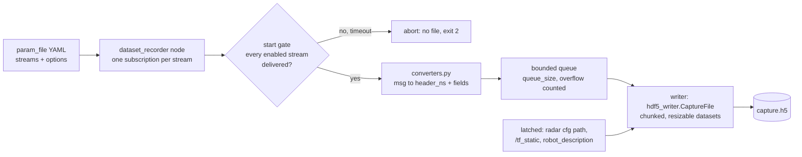
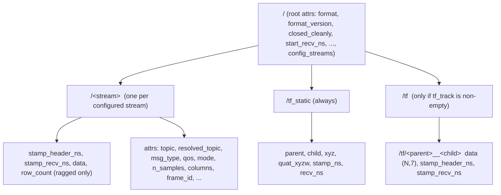

# dataset_generator: HDF5 capture format

Reference for the file `dataset_recorder` writes. How to read it (numpy/h5py examples, time alignment,
transforms, migrating a v1 `frame_N.npy` reader) is in [reading_datasets.md](reading_datasets.md).

`ros2 launch dataset_generator record_dataset.launch.py param_file:=radar_sar.yaml [output_file:=/path/x.h5] [namespace:=<ns>]`
runs the `dataset_recorder` node. Every file in `configs/` is a `param_file`. A YAML without `streams:` fails
at launch; the v1 `.npy` recorder is removed (`hdf5_to_legacy` converts a capture back to that layout).
One HDF5 file per capture, default `<dataset_path>/capture_<YYYYmmdd_HHMMSS>.h5` (current directory if
`dataset_path` is empty).

## Generation flow



Messages before the gate opens are discarded; latched inputs are held and written at gate open. The file is
flushed every `flush_period_s` and closed on SIGINT/SIGTERM or after `duration_s`. A killed process leaves
`closed_cleanly=False`; samples up to the last flush are readable, but file recovery after a kill is HDF5's
behaviour and is not tested here. Console's `record_h5.py` runs this same recorder as a job, so there is one format.

## YAML

```yaml
dataset_generator:
  ros__parameters:
    output_file: ""        # full path; launch arg output_file overrides
    dataset_path: "..."    # used when output_file is empty
    capture_mode: all      # all: every message | sampled: newest unseen message per tick
    sample_rate_hz: 10.0   # sampled-mode tick rate
    flush_period_s: 5.0
    duration_s: 0.0        # >0: stop and close cleanly after this long
    queue_size: 256        # writer queue (samples); overflow is counted, not blocking
    start_timeout_s: 30.0  # start gate: 0 = wait forever
    allow_missing: false   # true: start at the timeout anyway instead of aborting
    tf_topic: tf           # relative names resolve in the node namespace
    tf_static_topic: tf_static
    tf_track: ["odom->base_link"]   # flat "parent->child" strings; [""] = none
    robot_description_topic: robot_description   # "" = off; URDF goes to a root attr
    streams:
      <name>:              # HDF5 group name (no '.' or '/'; 'tf', 'tf_static' reserved)
        topic: radar_0/adc_data_cube
        type: raw_radar_msgs/msg/ADCDataCube
        enabled: true
        qos: reliable      # reliable | best_effort; default per type (below)
        qos_depth: 10      # reliable is raised to >= 10
        mode: all          # per-stream override of capture_mode
        fields: [x,y,z,vel]  # PointCloud2 columns (default: all fields)
        skip_nans: true      # PointCloud2: drop rows with a non-finite value
        compression: gzip    # optional (gzip | lzf), any stream
        legacy_folder: radar_0_adc  # folder name used by hdf5_to_legacy
        meta_for: radar_adc  # on an ADCChirpMeta stream: the cube stream to cross-check
        config_topic: radar_0/radar_config_path  # ADCDataCube only; default: topic with
                             # adc_data_cube -> radar_config_path (see Radar cfg)
```

Any `mount_*` key is accepted and kept verbatim in `config_streams`; it is an annotation only.

`type` (with or without `msg/`): `raw_radar_msgs/ADCDataCube`, `raw_radar_msgs/ADCChirpMeta`,
`sensor_msgs/{PointCloud2,Image,Imu,CameraInfo}`, `nav_msgs/Odometry`,
`geometry_msgs/{Twist,TwistStamped,TransformStamped,Vector3Stamped}`, `tf2_msgs/TFMessage`. Image encodings:
`mono8`/`8UC1`, `mono16`/`16UC1`, `32FC1`, `rgb8`/`bgr8`/`8UC3`, `rgba8`/`bgra8`; others are rejected
(counted in `n_dropped_node`). To add a type, add one function and one table row in `converters.py`.

QoS defaults: ADCDataCube, ADCChirpMeta and TFMessage `reliable`; all others `best_effort` (matches any
publisher). The ADC cube must be reliable: best-effort received 28 of 59 frames of a 3.4 MB SAR cube.

### Preset streams

Stream (group) names are the `streams:` keys of the YAML and are arbitrary. The presets in `configs/` enable the
streams below (disabled ones in parentheses). The last two columns are from the v1 recorder's config
(`git show 7f000a6^:src/dataset_generator/configs/<name>.yaml`; `ugv_dataset` is `ugv_dataset_v1.yaml`): the
`base_frame` its clouds were in, and `frame_rate_high_speed_sensors` (Hz), the timer behind its IMU/odom rows.

| preset | enabled streams (disabled) | v1 `base_frame` | v1 high-rate Hz |
|---|---|---|---|
| [ugv_dataset](../configs/ugv_dataset.yaml) | `radar_adc radar_pc camera vehicle_odom` (`camera_info lidar imu`) | `cpsl_ugv_1/base_footprint` | 50 |
| [uav_dataset](../configs/uav_dataset.yaml) | `radar_{front,back,down}_{adc,pc} lidar camera vehicle_odom` (`camera_info imu`) | `cpsl_uav_6/base_footprint` | 20 |
| [uav_dataset_radvel](../configs/uav_dataset_radvel.yaml) | radars as above, `lidar vehicle_odom` | `cpsl_uav_6/base_level` | 40 |
| [uav_dataset_radar_vs_flow](../configs/uav_dataset_radar_vs_flow.yaml) | radars, `lidar camera vehicle_odom` (`camera_info`) | `cpsl_uav_8/base_level` | 40 |
| [icaraus flow](../configs/uav_dataset_icaraus_dataset_flow.yaml), [radar](../configs/uav_dataset_icaraus_dataset_radar.yaml) | radars, `vehicle_odom` (`vicon`) | `cpsl_uav_8/base_footprint` | 40 |
| [human_movement](../configs/human_movement.yaml) | `radar_adc radar_pc camera camera_depth hand_left hand_right` (`camera_info camera_depth_info lidar imu vehicle_odom`) | `cpsl_realsense_color_optical_frame` | 50 |
| [radar_sar](../configs/radar_sar.yaml) | `radar_adc adc_meta` (`radar_pc`) | none (no v1) | none |
| [rover_pro_radar](../configs/rover_pro_radar.yaml) | `radar_adc adc_meta odom cmd_vel` | none (no v1) | none |

## File layout



Root attrs: `format="cpsl_dataset_hdf5"`, `format_version`, `closed_cleanly` (False until a clean close),
`start_recv_ns` (gate-open time), `end_recv_ns`, `last_flush_recv_ns`, `created_utc`, `host`, `ros_node`,
`namespace` (`/` if none), `capture_mode`, `sample_rate_hz`, `config_streams` (the stream table as JSON,
topics as configured), `timestamps` (field meaning), `start_gate` (JSON), `streams_missing`, `tf_track`,
`tf_topic`, `tf_static_topic` (resolved absolute names), and `robot_description` when a URDF arrived.

Every stream group has `stamp_header_ns` (int64 (N,), `-1` if the message has no header), `stamp_recv_ns`
(int64 (N,), host `time.time_ns()` at receipt; in `sampled` mode, of the chosen message) and, per type,
`data` (below). Common attrs: `topic` (as configured), `resolved_topic` (absolute), `msg_type`, `qos`,
`qos_depth`, `mode`, optional `legacy_folder`, `n_samples`, `n_errors` (samples the writer rejected, e.g. a
shape change against the first sample), `n_dropped_node` (converter errors plus queue overflow). A stream with
a `frame_index` field also gets `frame_index_first/last`, `frame_index_recorded_gaps` (uint32 wrap-safe) and
`frame_index_nonmonotonic`. `frame_id` is the first message's `header.frame_id` (no leading `/`, never
updated); `child_frame_id` likewise.

## Columns and dtypes per type

N = samples. `data` unless noted. Ragged: `row_count` int64 (N,), sample `i` is
`data[off[i]:off[i+1]]` with `off = concatenate([[0], cumsum(row_count)])`.

| Type | `data` dtype, shape | Columns (attr `columns`) | Other attrs |
|---|---|---|---|
| ADCDataCube | int16 (N,2,rx,sample,chirp) | `real`,`imag` along axis 1 | `axes`=`[re_im, rx, sample, chirp]` (labels from the message), `frame_id`, `radar_cfg_*` |
| ADCChirpMeta | none: one dataset per field (next table) | none | none (no `frame_id`, no `columns`) |
| PointCloud2 | float32 (rows,K), float64 if any field is double; ragged | `fields` option, else all message fields in order; integer fields cast to float; non-finite rows dropped if `skip_nans` | `columns`, `frame_id`, `skip_nans` |
| Image | per encoding (N,H,W) or (N,H,W,C): u8 / u16 / f32; C = 3 or 4 | none | `encoding`, `frame_id` |
| Imu | float64 (N,10) | qx qy qz qw wx wy wz ax ay az | `frame_id` |
| Odometry | float64 (N,13) | x y z qx qy qz qw vx vy vz wx wy wz (pose in `frame_id`, twist in `child_frame_id`) | `frame_id`, `child_frame_id` |
| Twist | float64 (N,6), stamp `-1` | vx vy vz wx wy wz | `columns` only |
| TwistStamped | float64 (N,6) | vx vy vz wx wy wz | `frame_id` |
| TransformStamped | float64 (N,7) | x y z qx qy qz qw | `frame_id`, `child_frame_id` |
| Vector3Stamped | float64 (N,3) | x y z | `frame_id` |
| CameraInfo | float64 (N,46) | width height K0..K8 R0..R8 P0..P11 D0..D13 (D NaN-padded; more than 14 is an error) | `frame_id`, `distortion_model` (str) |
| TFMessage (explicit stream only) | float64 (rows,7), ragged, stamp `-1` | x y z qx qy qz qw | `columns` |

Quaternions are x-first everywhere. A group whose payload shape or dtype changes against its first sample
rejects that sample (`n_errors`). An empty cloud has `row_count` 0.

ADCChirpMeta datasets (C chirps per frame; names as in the .msg):

| Dataset | dtype | shape |
|---|---|---|
| frame_index | uint32 | (N,) |
| record_valid, adc_complete, has_time, time_interpolated | bool | (N,C) |
| flags, run_idx | uint16 | (N,C) |
| global_chirp_idx | uint32 | (N,C) |
| ts_ticks | uint64 | (N,C) |
| sat_slices, sat_ref_lag | uint8 | (N,C) |
| sat_slices_aligned | int16 | (N,C) |
| t_s | float64 | (N,C) |
| prev_tail_sat | int16 | (N,2) |
| run_known | bool | (N,) |
| run_idx_frame | uint16 | (N,) |
| records_valid, records_invalid, records_other_run | uint32 | (N,) |

Lost-frame cross-check (written at close when the meta stream sets `meta_for`; the driver must run with
`publish_chirp_meta`; cube and meta matched on header stamp): cube attrs `meta_stream`, `n_without_meta`,
`frame_index_published` (span first..last of the meta stream, a lower bound if the meta topic itself lost
messages), `frame_index_recorded`, `frame_index_gap`; meta attrs `cube_stream`, `n_without_cube`. In `sampled`
mode gaps are expected.

## Format versions

`format_version` is the root attr. The writer constant is 4. Detect optional features by attribute or
group presence, never by version alone.

| Version | Added | Detect |
|---|---|---|
| 2 | first HDF5 recorder: root and stream attrs above (minus the ones below), `frame_id` on cube/cloud/image only, cross-check attrs; no radar cfg, no tf, no gate | `format_version == 2` |
| 3 | per cube stream `radar_cfg_topic`, `_status`, `_path`, `_text`, `_sha256`, `_metrics`, `_changed`; `config_topic` key in `config_streams` | `format_version >= 3`; `'radar_cfg_status' in attrs` |
| 3 with gate | the start gate shipped minutes before the bump to 4: root `start_gate`, `streams_missing`, file created at gate open | `'start_gate' in root.attrs` (a v3 file can have it; only development files do) |
| 4 | `/tf_static` (always), `/tf/<p>__<c>` per `tf_track`, root `tf_track`, `tf_topic`, `tf_static_topic`, optional `robot_description` | `format_version >= 4`; `'tf_static' in f` |

Additive changes with no version bump (detect by presence; older v4 files lack them):

| Change | Reader fallback |
|---|---|
| `frame_id` on Imu, Odometry, TwistStamped, TransformStamped, Vector3Stamped; `child_frame_id` on Odometry, TransformStamped | `attrs.get('frame_id')` |
| `tf_topic` / `tf_static_topic` hold resolved absolute names (older: as configured, default `/tf`, `/tf_static`) | treat as the name subscribed |
| root `namespace`; stream `resolved_topic`; cube `radar_cfg_resolved_topic` (also on tf pair groups) | fall back to `topic` |
| CameraInfo converter (new stream type) | none needed |

A v3 reader works on a v4 file if it skips `tf` and `tf_static`.

## Start gate

The file is created only when every **enabled** `streams:` entry has delivered a message, so every stream's
first sample is at or after `start_recv_ns` and no stream starts with an empty group. Only `streams:` entries
gate the start; tracked tf pairs, `/tf_static` and `robot_description` never do. The Create 3 puts its tf on
`/<ns>/tf`; the Rover Pro driver now publishes `odom->base_link` too, but the recorder would not wait for it.

| param | default | meaning |
|---|---|---|
| `start_timeout_s` | 30.0 | how long to wait for silent streams; `0` waits forever |
| `allow_missing` | false | at the timeout start anyway; silent streams keep empty groups and are listed in `streams_missing` |

At the timeout without `allow_missing` the node logs `GATE abort missing=<topics>`, creates **no file** and
exits with code **2**; stopping it (SIGINT/SIGTERM) before the gate opens also leaves no file.
State is one log line per change (`GATE waiting missing=a,b`, `GATE open wait_s=1.23`, `GATE abort
missing=a,b`) and the same as JSON on the latched `std_msgs/String` topic `~/gate`
(`{"state","missing","missing_topics","wait_s","timeout_s","allow_missing"}`). Root attr `start_gate` is JSON
`{"timeout_s","allow_missing","wait_s","opened_recv_ns"}`; `streams_missing` is a list of stream names.

## Transforms (format v4)

Using the transforms is in [reading_datasets.md](reading_datasets.md) section 4.

**`/tf_static`**: `parent`, `child` (vlen UTF-8, frame names without leading `/`), `xyz` (N,3) f64,
`quat_xyzw` (N,4) f64, `stamp_ns`, `recv_ns` (int64), attr `n_transforms`. One row per distinct (parent,
child): the last value received (`stamp_ns`/`recv_ns` are when that value first appeared). Subscribed
RELIABLE + TRANSIENT_LOCAL, so a latched publisher is caught late. Written at gate open, rewritten wholesale
when a pair is new or changes, and at close; N=0 if nothing arrived. Frame names are not namespace-stripped.

**Tracked `/tf` pairs**: each `tf_track` entry (flat `"parent->child"` strings; rcl parameters cannot hold
nested lists or an empty list, so "off" is `[""]`) becomes group `/tf/<parent>__<child>` (a `/` in a frame
becomes `.`). Only the direct edge is matched (leading `/` stripped); anything not exactly `a->b` is rejected
at startup; chains are not composed. Datasets `stamp_header_ns` (the transform's own stamp), `stamp_recv_ns`,
`data` float64 (N,7) `x y z qx qy qz qw`. Attrs `columns`, `parent_frame`, `child_frame`, `topic`,
`resolved_topic`, `msg_type`, `qos` (reliable, depth 100), `mode`, `n_samples`, `n_errors`,
`n_dropped_node`; no `frame_id`, no `row_count`. A pair that never appears gives a warning and
`n_samples=0` with no `data`. `[""]` (the `radar_sar` and `human_movement` presets) creates no `/tf` group.
Only samples after the gate opens are kept.

**`robot_description`**: root attr, URDF text of the last message on `robot_description_topic`
(RELIABLE + TRANSIENT_LOCAL); absent if no publisher.

## Radar cfg (format v3)

Each `ADCDataCube` stream carries the radar `.cfg` it was captured with. The driver (`ti_radar_connect`, in
the CPSL_TI_Radar repo) publishes the cfg path on `<radar_name>/radar_config_path` (`std_msgs/String`,
RELIABLE + TRANSIENT_LOCAL, depth 5); the recorder subscribes with the same QoS, reads the file on the
recording host and writes these stream attrs:

| attr | meaning |
|---|---|
| `radar_cfg_topic` / `radar_cfg_resolved_topic` | topic subscribed (`config_topic`, or the cube topic with `adc_data_cube` replaced by `radar_config_path`) |
| `radar_cfg_path` | path the driver reported (its view of the filesystem) |
| `radar_cfg_text` | the file's text (UTF-8, undecodable bytes replaced) |
| `radar_cfg_sha256` | SHA-256 of the raw bytes |
| `radar_cfg_metrics` | JSON of derived specs (below) |
| `radar_cfg_status` | `ok`; `unreadable: <error>` (path kept, no text/hash/metrics); `not_received` (written at close) |
| `radar_cfg_changed` | `True` if a later message named a different path (the first cfg is kept) |

`radar_cfg_metrics` comes from `radar_cfg.py`, a stdlib calculator for single-chip TDM cfgs. Keys: `scheme`
(`"tdm"`), `calculator`, `calculator_version`, `start_ghz`, `slope_mhz_us`, `idle_us`, `adc_start_us`,
`ramp_us`, `num_samples`, `sample_rate_ksps`, `bandwidth_mhz`, `center_ghz`, `lambda_mm`, `chirp_us`,
`sampling_us`, `n_rx`, `n_tx`, `n_virtual`, `n_az_virtual`, `chirps_per_loop`, `n_loops`, `n_chirps`,
`range_res_m`, `max_range_m` (0.9 x ideal), `max_range_ideal_m`, `velocity_res_ms`, `max_velocity_ms`,
`azimuth_res_deg`, `loop_period_us`, `doppler_bins`, `doppler_step_ms`, `frame_period_ms`, `frame_rate_hz`,
`num_frames`, `bytes_per_sample`, `bytes_per_chirp`, `bytes_per_frame`, `lvds_data_fmt`. A cfg it cannot
handle (advFrameCfg, cascade, missing commands) gives `{"error", "calculator", "calculator_version"}`;
DDMA and cascade metrics are not computed. The stored text lets you recompute the specs with the external
`radar_gui` tool (CPSL_TI_Radar); `test/test_radar_cfg.py` checks parity with it when it is importable.

## Install

`sudo apt install python3-h5py` (or `sudo bash scripts/deps/dataset.sh`); declared as `exec_depend`
in `package.xml`, so `rosdep install --from-paths src`, `scripts/install.sh`, the Docker image and console's
container install it automatically.
