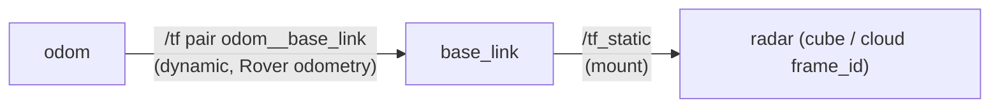

# Reading a dataset_generator HDF5 capture

Reader guide: h5py + numpy only, no ROS. Layout, columns and versions: [hdf5_format.md](hdf5_format.md).
Every block runs against a file the real writer produced (`capture.h5`). Stream names are arbitrary YAML keys;
presets and v1 base frames: [hdf5_format.md](hdf5_format.md) (Preset streams).

## 1. Open, detect, iterate

```python
import h5py, numpy as np
with h5py.File('capture.h5') as f:
    ver = f.attrs['format_version']                    # detect newer features by attribute, not version
    ok = bool(f.attrs['closed_cleanly'])               # False: the recorder died; data up to the last flush
    for n in f:
        if n not in ('tf', 'tf_static'):               # those two groups are not streams
            print(n, f[n].attrs['msg_type'], f[n].attrs['n_samples'], f[n].attrs.get('frame_id'))
```

Every stream group has `stamp_header_ns` and `stamp_recv_ns` (int64, one per sample); sample `i` of every
dataset in a group is the same message. A stream that never delivered (`allow_missing`) has an empty group.
Attributes written as lists (`columns`, `axes`) come back as object arrays of `str`.

## 2. One example per stream type

Radar cube (`int16 (N, 2, rx, sample, chirp)`, axis 1 real/imag), chirp meta (no `data`; one dataset per field,
per-chirp ones `(N, n_chirps)`) and a ragged PointCloud2 (`data (sum(rows), K)` plus `row_count (N,)`, names in
`columns`). Radar specs: `json.loads(f['radar_adc'].attrs['radar_cfg_metrics'])`.

```python
import h5py, numpy as np
with h5py.File('capture.h5') as f:
    d = f['radar_adc/data'][3].astype(np.float32)
    iq = d[0] + 1j * d[1]                              # complex (rx, sample, chirp)
    print(f['radar_adc'].attrs['axes'], iq.shape)
    m = f['adc_meta']
    print(m['frame_index'][:], m['t_s'].shape, m['record_valid'][2].all())
    g = f['radar_pc']
    off = np.concatenate([[0], np.cumsum(g['row_count'][:])])     # sample i = data[off[i]:off[i+1]]
    pts = g['data'][off[2]:off[3]]
    cols = list(g.attrs['columns'])                    # ['x', 'y', 'z', 'vel']
    xyz, vel = pts[:, :3], pts[:, cols.index('vel')]
```

Image (`(N, H, W[, C])` in the message encoding, attr `encoding`), Imu / Odometry / Twist (float64 rows, names in
`columns`) and CameraInfo (`float64 (N, 46)`: `width height K0..K8 R0..R8 P0..P11 D0..D13`, D NaN-padded).
Quaternions are x-first. Odometry pose is in `frame_id`, twist in `child_frame_id`; Twist has no header
(`stamp_header_ns == -1`), so use `stamp_recv_ns`.

```python
import h5py, numpy as np
with h5py.File('capture.h5') as f:
    img = f['camera/data'][0]                          # (H, W, 3) uint8; to BGR: V1_BGR in section 5
    imu = f['imu']; c = list(imu.attrs['columns'])     # qx qy qz qw wx wy wz ax ay az
    gyro = imu['data'][:, [c.index(k) for k in ('wx', 'wy', 'wz')]]
    od = f['odom']; c = list(od.attrs['columns'])      # x y z qx qy qz qw vx vy vz wx wy wz
    xy = od['data'][:, [c.index('x'), c.index('y')]]
    print(od.attrs['frame_id'], od.attrs['child_frame_id'], f['cmd_vel/stamp_header_ns'][0])
    row = f['cam_info/data'][0]; D = row[-14:]         # K0..K8, D0..D13 are named in `columns`
    print(row[2:11].reshape(3, 3)[0, 0], D[~np.isnan(D)])
```

## 3. Time alignment across streams

`stamp_header_ns` is the sensor's clock (`-1` if unstamped); `stamp_recv_ns` is the recording host's clock,
common to all streams. Use header stamps when the drivers share a clock, else `stamp_recv_ns`. Index `i` of one stream
is unrelated to index `i` of another.

```python
import h5py, numpy as np
with h5py.File('capture.h5') as f:
    t = f['radar_pc/stamp_header_ns'][:]
    ti = f['imu/stamp_header_ns'][:]
    j = np.clip(np.searchsorted(ti, t), 1, len(ti) - 1)
    near = j - ((t - ti[j - 1]) < (ti[j] - t))         # nearest IMU sample per cloud
    last = np.searchsorted(ti, t, side='right') - 1    # newest IMU at or before it; -1 = none yet
    win = [np.flatnonzero((ti > a) & (ti <= b)) for a, b in zip(t[:-1], t[1:])]  # IMU between clouds
    print(near, last, [len(w) for w in win])
```

## 4. Transforms and the tf tree

The file does **not** move data into the body frame. Clouds, radar, images and IMU stay in their sensor
frame (`frame_id` attr = the first message's `header.frame_id`, no leading `/`). Storage of `/tf_static`, the tracked `/tf/<parent>__<child>` pairs and the root attrs is in
[hdf5_format.md](hdf5_format.md) (Transforms). `robot_description` (root attr, URDF text) exists only if a
publisher existed; `<joint><origin xyz rpy>` mirrors the mounts, but `/tf_static` is authoritative.

Every transform is `T_parent_child` (maps `child` coordinates into `parent`). Only `tf_track` edges are
recorded over time; any other moving link is not in the file.



Rover Pro radar preset. Frame names may carry the robot namespace (`cpsl_uav_6/base_footprint`): list them (last block
below). If your v1 base frame (preset table in hdf5_format.md) is missing, pass another
frame as `up_to`; clouds then differ from v1 by that fixed offset. A base edge that is a tracked pair moves:
use `pose_at`, not `static_chain`.

**Sensor to base frame (what v1 did).** v1 transformed point clouds (x, y, z only; `vel` and `intensity`
untouched) into the preset's base frame using the newest tf at save time. For a fixed mount that is the
static chain: `T_base_sensor` is the whole answer. For a moving chain, add the tracked pair as below.

```python
import h5py, numpy as np

def T(xyz, q):                                         # 4x4 from x y z, qx qy qz qw
    x, y, z, w = np.asarray(q) / np.linalg.norm(q)
    M = np.eye(4)
    M[:3, :3] = [[1-2*(y*y+z*z), 2*(x*y-z*w),   2*(x*z+y*w)],
                 [2*(x*y+z*w),   1-2*(x*x+z*z), 2*(y*z-x*w)],
                 [2*(x*z-y*w),   2*(y*z+x*w),   1-2*(x*x+y*y)]]
    M[:3, 3] = xyz
    return M

def static_chain(f, frame, up_to):                     # T_up_to_frame from /tf_static
    g = f['tf_static']
    parent, child = g['parent'].asstr()[:], g['child'].asstr()[:]
    M = np.eye(4)
    while frame != up_to:
        i = list(child).index(frame)                   # ValueError: no static path up to `up_to`
        M = T(g['xyz'][i], g['quat_xyzw'][i]) @ M
        frame = parent[i]
    return M

def pose_at(g, t_ns, interpolate=True):                # tracked group -> T_parent_child at t
    ts, d = g['stamp_header_ns'][:], g['data'][:]
    j = int(np.clip(np.searchsorted(ts, t_ns), 1, max(len(ts) - 1, 1)))
    a, b = max(j - 1, 0), min(j, len(ts) - 1)
    if not interpolate:                                # nearest sample
        a = a if abs(t_ns - ts[a]) <= abs(ts[b] - t_ns) else b
        return T(d[a, :3], d[a, 3:])
    u = 0.0 if ts[b] == ts[a] else float(np.clip((t_ns - ts[a]) / (ts[b] - ts[a]), 0, 1))
    qa, qb = d[a, 3:], d[b, 3:]
    qb = -qb if qa @ qb < 0 else qb                    # same hemisphere, then nlerp (small steps)
    return T((1-u) * d[a, :3] + u * d[b, :3], (1-u) * qa + u * qb)

with h5py.File('capture.h5') as f:
    sg = f['tf_static']                                # which frames, and is the base edge static?
    frames = sorted(set(sg['parent'].asstr()[:]) | set(sg['child'].asstr()[:]))
    print(frames, 'base_footprint' in frames)
    g = f['radar_pc']
    off = np.concatenate([[0], np.cumsum(g['row_count'][:])])
    i = 2
    pts = g['data'][off[i]:off[i + 1]].astype(np.float64)       # x y z vel, sensor frame
    T_base_sensor = static_chain(f, g.attrs['frame_id'], 'base_footprint')
    xyz_base = pts[:, :3] @ T_base_sensor[:3, :3].T + T_base_sensor[:3, 3]
    v1_cloud = np.c_[xyz_base, pts[:, 3]].astype(np.float32)    # what v1 saved: (n, 4)
    # a world (odom) frame needs the dynamic edge at the cloud's stamp
    trk = f['tf/odom__base_link']
    T_odom_base = pose_at(trk, g['stamp_header_ns'][i])         # interpolate=False: nearest sample
    T_odom_sensor = T_odom_base @ static_chain(f, g.attrs['frame_id'], trk.attrs['child_frame'])
    xyz_odom = pts[:, :3] @ T_odom_sensor[:3, :3].T + T_odom_sensor[:3, 3]
    print(v1_cloud[0], xyz_odom[0])
```

`pose_at` interpolates the tracked edge at the sample's stamp (clamped to the tracked range); use
`stamp_recv_ns` if the clocks differ.

## 5. Migrating a v1 `frame_N.npy` reader

v1 wrote `<dataset>/<folder>/frame_<N>.npy` (camera and depth `.png`), one file per folder per save tick,
`N` from 10000. The HDF5 file has one group per stream and one row per message.

| v1 folder / file | HDF5 group (name from the YAML) and read | Difference |
|---|---|---|
| `<radar>_adc`: complex128 `(rx, sample, chirp)` | `radar_adc/data`: `d[:,0] + 1j*d[:,1]` | every cube is kept (reliable QoS); per-sample stamps; cfg text in attrs; `adc_meta` per-chirp info |
| `<radar>_pc`: float32 `(n, 4)` x y z vel, **base frame** | `radar_pc`: ragged slice, **sensor frame** | apply `T_base_sensor` (section 4); NaN rows dropped as before |
| `lidar`: float32 `(n, 4)` x y z intensity, base frame | `lidar` ragged | as above; columns follow `columns` (set `fields` to match) |
| `camera`: 8-bit BGR `.png`; `depth`: `.png` as published | `camera/data[i]`, `camera_depth/data[i]` | message encoding (`encoding` attr): convert with `V1_BGR` below, write PNGs yourself; depth needs none |
| `hands`: `(2, n, 3)`, base frame | `hand_left`, `hand_right` ragged, sensor frame | two streams (v1 transformed both to the base frame: apply `T_base_sensor`); `np.stack` yourself, counts may differ |
| `imu_data`: `(m, 7)` t wx wy wz ax ay az | `imu/data` cols `wx wy wz ax ay az` | one row per message (v1 repeated the latest row); has orientation; v1 t was the node clock in s; use `stamp_recv_ns` |
| `vehicle_odom`: `(m, 14)` t x y z **qw qx qy qz** vx vy vz wx wy wz | `odom/data`: x y z **qx qy qz qw** vx vy vz wx wy wz | quaternion reorder on the raw 13 columns (below); no time column |
| `vehicle_vel`: `(m, 3)` t vx wz | none | `odom` columns `vx`, `wz` |
| `vicon_<segment>`: `(7,)` x y z **qw qx qy qz** | a `TransformStamped` stream, `data (N, 7)` x y z **qx qy qz qw** | reorder |

Recipe, on **one clock, `stamp_recv_ns`** (host clock, shared by all streams; header stamps only if the
drivers share a clock, section 3). Each v1 save tick wrote the newest message per sensor; its IMU/odom files
held one row per tick of a timer (`frame_rate_high_speed_sensors`: 20 to 50 Hz by preset, `hdf5_format.md`) that
repeated the newest message, since the previous save tick, with the node clock in seconds as column 0.

```python
import h5py, numpy as np

def latest(g, t, key='stamp_recv_ns'):                 # index of newest sample <= t, -1 = none yet
    return np.searchsorted(g[key][:], t, side='right') - 1

def gray(a):                                           # 1 channel -> BGR, as cv_bridge does for "bgr8"
    return np.repeat(a[..., None], 3, 2)

V1_BGR = {                                             # encoding -> v1 camera PNG (uint8 H, W, 3 BGR)
    'bgr8': lambda a: a, 'rgb8': lambda a: a[..., ::-1],              # 8UC1, 8UC3, 16UC1, 32FC1: cv_bridge
    'rgba8': lambda a: a[..., 2::-1], 'bgra8': lambda a: a[..., :3],  # refuses these, v1 wrote no PNG
    'mono8': gray, 'mono16': lambda a: gray(np.rint(a * (255 / 65535)).astype(np.uint8))}

with h5py.File('capture.h5') as f:
    imu, od, ref = f['imu'], f['odom'], f['radar_pc']['stamp_recv_ns'][:]   # ticks: any stream's stamps
    k = 2; prev, tick = ref[k - 1], ref[k]             # row k of the tick stream = v1 frame 10000 + k
    dt = int(1e9 / 50)                                 # v1 high-rate period: the preset's Hz
    grid = np.arange(prev + dt, tick + 1, dt)          # timer ticks in (prev, tick]
    gi, go, j = latest(imu, grid), latest(od, grid), latest(f['radar_adc'], tick)
    if min(gi.min(initial=0), go.min(initial=0), j) < 0:    # a stream has no sample yet: skip (v1 did too)
        print('skip tick', k)
    else:
        t = grid * 1e-9
        v1_imu = np.c_[t, imu['data'][:][gi][:, 4:10]]                    # t wx wy wz ax ay az
        q_wfirst = [0, 1, 2, 6, 3, 4, 5, 7, 8, 9, 10, 11, 12]             # raw: x y z qx qy qz qw vx.. wz
        v1_odom = np.c_[t, od['data'][:][go][:, q_wfirst]]                # t x y z qw qx qy qz vx vy vz wx wy wz
        v1_vel = v1_odom[:, [0, 8, 13]]                # t vx wz: v1 columns after t and the 4 quaternion terms
        cam = f['camera']
        png = V1_BGR[cam.attrs['encoding']](cam['data'][latest(cam, tick)])
        print(v1_imu.shape, v1_odom.shape, v1_vel[0], j, png.shape)
```

The start gate opens once every stream (bar `allow_missing` ones, which stay empty) has delivered, but earlier
messages are not stored, so first rows differ slightly: start at the `max` of the streams' first `stamp_recv_ns`.

Behavioural differences:

- **Frame and time.** v1 clouds were in the preset's `base_frame` (section 4), not `base_link`; v1 stored no
  header stamp. `capture_mode: sampled` (newest unseen message per tick) is closest to v1.
- **Numbering and ticks.** v1 `frame_10000 + k` is tick `k`; HDF5 rows (and `hdf5_to_legacy` `frame_k`) start
  at 0. v1 skipped a tick until every sensor had data and emptied its folders at start; now the start gate
  waits once and each capture is a new `.h5`.
- **Export tool.** `ros2 run dataset_generator hdf5_to_legacy capture.h5 out_dir [--reference STREAM]` writes
  `frame_<idx>.npy` from 0 per sample of the reference stream (default: first stream in h5py order,
  **alphabetical**, so pass `--reference`), with each other stream's newest sample at or before it. Output is
  sensor-frame, x-first quaternions, one latest IMU/odom row, no `vehicle_vel`, no PNG.
